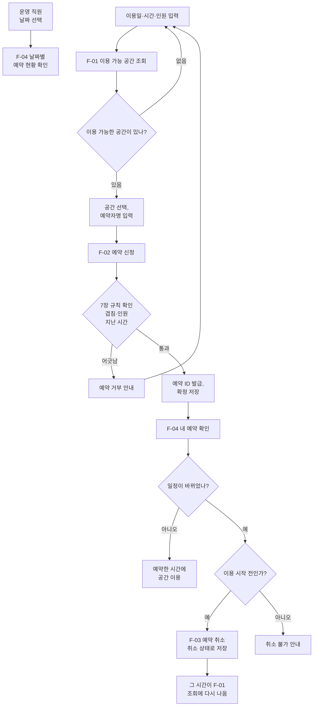

# 모아공간 예약 관리 시스템 구축 제안요청서

> 과제: 발주기획안 (RFP.md) · 버전 v0.6 (공동 작성 중) · 최종 수정 2026-11-05
>
> 작성: (3조) 모아공간 — 서비스 책임자 · 사용자 대표 · 운영 담당

## 목차와 작성 담당

| 구분 | 장 | 과제 양식 항목 | 작성 | 검토 | 상태 |
| :---: | :---: | :---: | :---: | :---: | :---: |
| **Ⅰ. 사업 개요** | [1. 발주 회사와 사용자](#1-발주-회사와-사용자) | 회사와 사용자 | 서비스 책임자 | 전원 | 초안 완료 |
|  | [2. 사업 목적과 추진 배경](#2-사업-목적과-추진-배경) | 문제와 목표 | 서비스 책임자 | 사용자 대표 | 초안 완료 |
|  | [3. 사업 범위](#3-사업-범위) | 개발 범위 | 서비스 책임자 | 운영 담당 | 초안 완료 |
| **Ⅱ. 사업 추진 방안** | [4. 업무 흐름](#4-업무-흐름) | 업무 흐름 | 사용자 대표 | 서비스 책임자 | 검토 완료 |
|  | [5. 추진 체계와 일정](#5-추진-체계와-일정) | 역할 분담 | 서비스 책임자 | 전원 | 초안 완료 |
| **Ⅲ. 제안 요청 내용** | [6. 요구사항 총괄표](#6-요구사항-총괄표) | 기능·비기능 요구사항 | 서비스 책임자 | 전원 | 초안 완료 |
|  | [7. 공통 업무 규칙](#7-공통-업무-규칙) | 기능 요구사항 | 서비스 책임자 | 운영 담당 | 초안 완료 |
|  | [8. 기능 요구사항](#8-기능-요구사항) | 기능 요구사항 | 사용자 대표 | 서비스 책임자 | 검토 완료 |
|  | [9. 데이터 요구사항](#9-데이터-요구사항) | 개발 범위 (가상 데이터) | 운영 담당 | 사용자 대표 | 초안 완료 |
|  | [10. 비기능 요구사항](#10-비기능-요구사항) | 비기능 요구사항 | 운영 담당 | 서비스 책임자 | 검토 완료 |
|  | [11. 테스트 요구사항 (완료 기준)](#11-테스트-요구사항-완료-기준) | 완료 기준 | 운영 담당 | 사용자 대표 | 초안 완료 |
|  | [12. 산출물](#12-산출물) | 개발 완료 시 산출물 | 서비스 책임자 | 운영 담당 | 초안 완료 |
| **Ⅳ. 질의응답 안내** | [13. 질의응답과 변경 절차](#13-질의응답과-변경-절차) | 질의응답 (QNA.md) | 서비스 책임자 | 전원 | 초안 완료 |
|  | [변경 이력](#변경-이력) | 수정 전 / 후 | 수정한 사람 | 서비스 책임자 | 계속 기록 |

**상태 표시**: `작성 필요` → `초안 완료` → `검토 완료`. 자기 장을 다 쓰거나 검토를 마치면 이 표의 상태를 바꾼다.

## 공동 작성 규칙

1. 각자 **자기 담당 장만 직접 수정**한다. 다른 장에 의견이 있으면 GitHub Issue를 열거나 담당자에게 말한다.
2. 각 장 맨 위의 `작성 · 검토` 줄에 역할을 적는다.
3. `작성 가이드` 상자와 `(작성)` 표시는 내용을 채운 뒤 지운다.
4. 커밋 메시지에 장 번호를 적는다. 예: `RFP 11장 완료 기준 작성`. 저장소 커밋 기록이 그대로 개인 기여와 수정 기록이 된다.
5. 7장 공통 업무 규칙과 다른 규칙이 필요하면 서비스 책임자와 먼저 정한 뒤 7장을 고친다.
6. 질의응답으로 바뀐 내용은 맨 끝 변경 이력에 질문 ID와 함께 적는다.

## Ⅰ. 사업 개요

### 1. 발주 회사와 사용자

> 작성: 서비스 책임자 · 검토: 전원

| 항목 | 내용 |
| :---: | :---: |
| 사업명 | 모아공간 예약 관리 시스템 구축 |
| 발주 회사 | 모아공간 |
| 업종 | 회의실과 연습실을 시간 단위로 빌려주는 공간 운영회사 |
| 대상 사용자 | **예약 고객**: 원하는 시간에 맞는 공간을 찾아 예약하고 취소하는 사람 **운영 직원**: 날짜별 예약 현황을 확인하고 관리하는 사람 |

### 2. 사업 목적과 추진 배경

> 작성: 서비스 책임자 · 검토: 사용자 대표

**추진 배경 (현재 업무의 문제)**

- 예약을 전화와 메신저로 받아 수기 장부에 적고 있어, 같은 공간·같은 시간에 예약이 두 번 잡히는 일이 생긴다.
- 고객이 원하는 시간에 비어 있는 공간이 있는지 직원이 장부를 일일이 넘겨 봐야 알 수 있다.
- 신청 인원이 공간의 수용 인원보다 많아도 걸러지지 않는다.
- 취소된 예약을 지우거나 덧칠해 버려, 나중에 취소 기록을 확인할 수 없다.

**사업 목적 (개선할 결과)**

- 공간 정보와 예약 정보를 CSV 파일(`spaces.csv`, `reservations.csv`)로 관리한다.
- 같은 공간에서 시간이 겹치는 확정 예약이 생기지 않도록 시스템이 막는다.
- 이용일·시간·인원만 입력하면 바로 이용할 수 있는 공간 목록을 보여준다.
- 취소한 예약도 지우지 않고 상태로 구분해 기록을 남긴다.

### 3. 사업 범위

> 작성: 서비스 책임자 · 검토: 운영 담당

**포함**

- 6장 요구사항 총괄표의 기능 F-01 ~ F-04
- 고객 화면과 운영 직원 화면 (사이드바 메뉴로 구분, 로그인 없음)
- 9장 가상 데이터로 로컬 PC에서 시연

**제외**

- 회원가입·로그인, 결제, 문자·메일 알림
- 실제 서버 배포, 실제 고객 개인정보 사용
- 예약 변경 기능 (변경이 필요하면 취소 후 다시 예약)

**개발 환경 (제약 사항)**

| 항목 | 내용 |
| :---: | :---: |
| 화면 | Streamlit |
| 데이터 처리 | pandas |
| 저장 | CSV 파일 (데이터베이스는 사용하지 않음) |
| 실행 | 로컬 PC에서 `streamlit run app.py` |

## Ⅱ. 사업 추진 방안

### 4. 업무 흐름

> 작성: 사용자 대표 · 검토: 서비스 책임자

#### 4.1 사용 상황

| 사용자 | 상황 | 필요한 결과 |
| :---: | :---: | :---: |
| 예약 고객 | 동아리 6명이 다음 주 금요일 오후에 2시간 연습할 곳을 찾는다. | 그 시간에 6명이 들어갈 수 있는 빈 연습실 목록 |
| 예약 고객 | 스터디 대표가 11월 20일 10:00~12:00에 잡아 둔 회의실 B 예약을 확인하다가, 모임이 미뤄져 예약을 취소한다. | 예약 ID로 찾은 내 예약 내용, 취소한 뒤 상태가 '취소'로 바뀌었다는 안내 |
| 운영 직원 | 운영 직원이 아침에 오늘 예약 현황을 보고 어느 공간에 언제 손님이 오는지 확인한다. | 그날 예약 목록 (공간·시작 시간 순, 확정과 취소 구분) |

#### 4.2 업무 순서

1. 고객이 이용일, 시작·종료 시간, 인원을 입력해 이용 가능한 공간을 조회한다. 필요하면 공간 유형도 고른다. (F-01)
2. 이용 가능한 공간이 없으면 날짜·시간·인원을 바꿔 다시 조회하고, 있으면 목록에서 공간을 고른다. (F-01)
3. 고른 공간에 예약자명을 입력해 예약을 신청한다. 시스템이 7장 규칙(시간 겹침, 수용 인원, 지난 시간)을 다시 확인해 통과하면 예약 ID를 발급하고 확정으로 저장한다. 통과하지 못하면 예약을 거부하고 다시 조회하게 한다. (F-02)
4. 고객은 예약 ID와 예약자명으로 자기 예약을 확인한다. (F-04)
5. 일정이 바뀌면 이용 시작 전에 예약 ID와 예약자명으로 예약을 취소한다. 예약은 지워지지 않고 상태만 취소로 바뀌며, 그 시간은 F-01 조회에 다시 나온다. 시간을 바꾸려면 취소 후 다시 예약한다. (F-03)
6. 운영 직원은 날짜로 예약 내역을 조회해 공간별 이용 현황을 확인한다. (F-04)

#### 4.3 흐름도

### 5. 추진 체계와 일정

> 작성: 서비스 책임자 · 검토: 전원

#### 5.1 추진 체계 (발주 측 역할 분담)

| 역할 | 담당 장 | 담당 업무 | 질의응답에서 맡는 답변 |
| :---: | :---: | :---: | :---: |
| 서비스 책임자 | 1, 2, 3, 5, 6, 7, 12, 13장 | 목표와 기능 범위 결정 | 범위·규칙 질문, 유지 / 수정 / 보류 최종 결정 |
| 사용자 대표 | 4, 8장 | 사용 상황과 필요한 결과 설명 | 화면·입력·결과에 관한 질문 |
| 운영 담당 | 9, 10, 11장 | 예외 상황과 완료 기준 검토 | 예외 처리·데이터·완료 기준에 관한 질문 |

#### 5.2 추진 일정

| 단계 | 내용 | 날짜 | 담당 |
| :---: | :---: | :---: | :---: |
| RFP 초안 완성 | 담당 장 작성과 검토 완료 | 2026-11-05 | 전원 |
| 질의 접수 | 개발회사 역할 팀이 Issue로 질문 등록 | 2026-11-10 | 상대 팀 |
| 상대 팀 질의 | 3조가 개발회사 역할로 상대 팀 저장소 Issue에 질문 등록 | 2026-11-10 | 전원 |
| 답변과 반영 | 답변 등록, RFP 수정, 변경 이력 기록 | 2026-11-10 | 전원 |
| 최종 제출 | 팀 보고서 PDF, 저장소 URL 제출 | 2026-11-XX | 전원 |

## Ⅲ. 제안 요청 내용

### 6. 요구사항 총괄표

> 작성: 서비스 책임자 · 검토: 전원

#### 6.1 요구사항 분류

실제 공공 RFP의 요구사항 분류와 이 문서의 대응 관계다. 기능 번호는 과제에서 정한 F-01 형식을 그대로 쓴다.

| 실제 RFP 분류 | 코드 | 이 문서 | 개수 |
| :---: | :---: | :---: | :---: |
| 기능 요구사항 | SFR | 8장 F-01 ~ F-04 | 4 |
| 데이터 요구사항 | DAR | 9장 D-01 | 1 |
| 성능·보안·품질 요구사항 | PER·SER·QUR | 10장 NFR-01 ~ NFR-02 | 2 |
| 테스트 요구사항 | TER | 11장 완료 기준 | 기능별 |
| 제약 사항 | COR | 3장 개발 환경 | - |
| 장비·인터페이스·프로젝트 지원 | ECR·SIR·PSR | 해당 없음 (로컬 시연이라 장비 도입과 외부 연동이 없음) | 0 |

#### 6.2 요구사항 목록

| 고유번호 | 분류 | 요구사항 명칭 | 상세 | 작성 | 우선순위 |
| :---: | :---: | :---: | :---: | :---: | :---: |
| F-01 | 기능 | 시간·인원별 공간 조회 | 8장 | 사용자 대표 | 높음 |
| F-02 | 기능 | 공간 예약 | 8장 | 사용자 대표 | 높음 |
| F-03 | 기능 | 예약 취소 | 8장 | 사용자 대표 | 높음 |
| F-04 | 기능 | 예약 내역 조회 | 8장 | 사용자 대표 | 중간 |
| D-01 | 데이터 | 공간·예약 가상 데이터 | 9장 | 운영 담당 | 높음 |
| NFR-01 | 품질 | 예약 데이터 보존 | 10장 | 운영 담당 | 중간 |
| NFR-02 | 보안 | 개인정보 미수집 | 10장 | 운영 담당 | 중간 |

> 질의응답 후 기능을 추가하더라도 최종 기능은 5개 이하로 한다.

### 7. 공통 업무 규칙

> 작성: 서비스 책임자 · 검토: 운영 담당

모든 기능에 똑같이 적용되는 규칙이다. 8장과 11장은 이 규칙을 따라 작성한다.

| 규칙 | 내용 |
| :---: | :---: |
| 운영 시간 | 매일 09:00 ~ 22:00. 시작은 09:00부터, 종료는 22:00까지 가능하다. |
| 예약 단위 | 1시간 단위, 한 번에 최소 1시간 ~ 최대 4시간 |
| 예약 가능 시점 | 이미 지난 날짜·시간은 예약할 수 없다. 시작 시각이 현재 시각보다 뒤여야 한다. |
| 시간 겹침 판단 | 같은 공간·같은 이용일에서 `새 시작 < 기존 종료` 그리고 `새 종료 > 기존 시작`이면 겹침으로 본다. 앞 예약의 종료 시각과 뒤 예약의 시작 시각이 같은 경우(예: 10:00-12:00 예약 뒤에 12:00-13:00 예약)는 허용한다. |
| 겹침 대상 | 상태가 **확정**인 예약만 비교한다. 취소된 예약은 비교하지 않는다. |
| 정리 시간 | 초안에서는 예약 사이 정리 시간을 두지 않는다. |
| 신청 인원 | 1명 이상, 공간의 수용 인원 이하 |
| 예약자명 | 필수 입력이며 빈칸은 받지 않는다. |
| 본인 확인 | 예약 취소와 고객의 예약 조회는 예약 ID와 예약자명이 모두 맞아야 한다. 없는 예약 ID와 예약자명 불일치는 같은 안내 문구("예약 정보가 일치하지 않습니다")로 알린다. |
| 취소 가능 시점 | 이용 시작 시각 전까지 |
| 취소 처리 | 예약을 지우지 않고 상태만 `취소`로 바꾼다. |
| 예약 상태 | `확정`, `취소` 두 가지 |

### 8. 기능 요구사항

> 작성: 사용자 대표 · 검토: 서비스 책임자

#### F-01 시간·인원별 공간 조회

| 항목 | 내용 |
| :---: | --- |
| 요구사항 분류 | 기능 요구사항 |
| 고유번호 | F-01 |
| 요구사항 명칭 | 시간·인원별 공간 조회 |
| 정의 | 이용일·시간·인원 조건에 맞는 빈 공간을 찾아 보여준다. |
| 사용자 | 예약 고객, 운영 직원 |
| 입력 | 이용일, 시작 시간, 종료 시간, 인원, 공간 유형(회의실/연습실, 고르지 않으면 전체) |
| 처리 | 1) 입력값이 공통 업무 규칙(운영 시간, 예약 단위, 지난 시간 여부, 인원 1명 이상)에 맞는지 확인 2) 공간 유형을 골랐으면 그 유형의 공간만 남김 3) 수용 인원이 입력 인원 이상인 공간만 고름 4) 그중 해당 시간에 확정 예약이 겹치지 않는 공간만 남김 |
| 결과 | 이용 가능한 공간 목록(공간 ID, 공간명, 유형, 수용 인원)을 수용 인원이 작은 순으로 표시 |
| 관련 요구사항 | F-02 (조회한 공간을 골라 예약), 7장 공통 업무 규칙 |
| 우선순위 | 높음 |

#### F-02 공간 예약

| 항목 | 내용 |
| :---: | --- |
| 요구사항 분류 | 기능 요구사항 |
| 고유번호 | F-02 |
| 요구사항 명칭 | 공간 예약 |
| 정의 | F-01에서 고른 공간을 원하는 시간에 확정 예약으로 저장하고 예약 ID를 발급한다. |
| 사용자 | 예약 고객 |
| 입력 | 공간 (F-01 결과 목록에서 선택), 예약자명 이용일, 시작 시간, 종료 시간, 인원은 F-01에서 입력한 값을 그대로 사용 |
| 처리 | 1) 입력값이 공통 업무 규칙(운영 시간, 예약 단위, 지난 시간 여부, 신청 인원, 예약자명)에 맞는지 다시 확인 2) 저장 직전에 같은 공간의 확정 예약과 시간이 겹치지 않는지 다시 확인 (조회한 뒤 다른 예약이 먼저 들어왔을 수 있음) 3) 마지막 예약 ID 다음 번호로 예약 ID 생성 (R + 네 자리, 예: R0003 다음은 R0004) 4) 예약 상태를 확정으로 해서 reservations.csv에 저장 |
| 결과 | 예약 완료 안내와 예약 ID, 공간명, 이용일, 시간, 인원, 예약자명 표시 예약 ID는 취소와 조회에 쓰이므로 눈에 띄게 보여준다 |
| 관련 요구사항 | F-01 (조회한 공간 선택), F-03·F-04 (예약 ID로 취소·조회), 7장 공통 업무 규칙, 9.1 데이터 형식 |
| 우선순위 | 높음 |

#### F-03 예약 취소

| 항목 | 내용 |
| :---: | --- |
| 요구사항 분류 | 기능 요구사항 |
| 고유번호 | F-03 |
| 요구사항 명칭 | 예약 취소 |
| 정의 | 예약 고객이 이용 시작 전에 자기 예약을 취소한다. 예약은 지우지 않고 상태만 취소로 바꾼다. |
| 사용자 | 예약 고객 |
| 입력 | 예약 ID, 예약자명 (두 값이 모두 맞아야 본인 예약으로 봄) |
| 처리 | 1) 예약 ID로 예약을 찾고 예약자명이 같은지 확인 2) 예약 상태가 확정인지 확인 3) 지금이 이용 시작 시각 전인지 확인 (7장 취소 가능 시점) 4) 취소할 예약 내용(공간명, 이용일, 시간)을 보여 주고, 고객이 [취소 확정]을 한 번 더 누르면 다음으로 넘어감 5) 예약 상태를 취소로 바꿔 저장하고 행은 지우지 않음 (7장 취소 처리) |
| 결과 | 취소 완료 안내와 취소된 예약 내용(예약 ID, 공간명, 이용일, 시간) 표시 그 시간은 F-01 조회에서 다시 이용 가능한 공간으로 나온다. |
| 관련 요구사항 | F-02 (예약 ID 발급), F-04 (취소 상태 확인), F-01 (취소된 시간 다시 조회), 7장 취소 가능 시점·취소 처리 |
| 우선순위 | 높음 |

#### F-04 예약 내역 조회

| 항목 | 내용 |
| :---: | --- |
| 요구사항 분류 | 기능 요구사항 |
| 고유번호 | F-04 |
| 요구사항 명칭 | 예약 내역 조회 |
| 정의 | 예약 고객은 자기 예약을, 운영 직원은 날짜별 전체 예약을 찾아 표로 보여준다. |
| 사용자 | 예약 고객, 운영 직원 |
| 입력 | 예약 고객: 예약 ID, 예약자명 운영 직원: 이용일 (공간은 선택) |
| 처리 | 1) 예약 고객: 예약 ID로 예약을 찾고 예약자명이 같은지 확인 (F-03과 같은 방식) 2) 운영 직원: 고른 이용일의 예약을 찾고, 공간을 고르면 그 공간만 남김 3) 운영 직원 결과는 공간 ID, 시작 시간 순으로 정렬 |
| 결과 | 예약 ID, 공간명, 이용일, 시작·종료 시간, 신청 인원, 예약자명, 예약 상태를 표로 표시 취소된 예약도 지우지 않았으므로 함께 보이고, 상태 칸에 취소로 구분된다 |
| 관련 요구사항 | F-02 (예약 ID), F-03 (취소할 예약 찾기), 3장 고객 화면·운영 직원 화면, 9.3 예약 정보 |
| 우선순위 | 중간 |

### 9. 데이터 요구사항

> 작성: 운영 담당 · 검토: 사용자 대표

| 항목 | 내용 |
| :---: | :---: |
| 고유번호 | D-01 |
| 요구사항 명칭 | 공간·예약 가상 데이터 |
| 정의 | 공간 정보(`spaces.csv`)와 예약 정보(`reservations.csv`) 두 파일로 시연한다. 실제 개인정보는 넣지 않는다. |

#### 9.1 데이터 형식

| 항목 | 형식 | 예 |
| :---: | :---: | :---: |
| 공간 ID | S + 두 자리 번호 | S01 |
| 예약 ID | R + 네 자리 번호 | R0001 |
| 이용일 | YYYY-MM-DD | 2026-11-20 |
| 시작·종료 시간 | HH:MM (정각) | 14:00 |
| 예약 상태 | `확정` 또는 `취소` | 확정 |

#### 9.2 `spaces.csv` (공간 정보)

| 공간 ID | 공간명 | 유형 | 수용 인원 |
| :---: | :---: | :---: | :---: |
| S01 | 회의실 A | 회의실 | 4 |
| S02 | 회의실 B | 회의실 | 8 |
| S03 | 세미나실 | 회의실 | 20 |
| S04 | 밴드 연습실 | 연습실 | 6 |
| S05 | 댄스 연습실 | 연습실 | 12 |

#### 9.3 `reservations.csv` (예약 정보)

| 예약 ID | 공간 ID | 이용일 | 시작 시간 | 종료 시간 | 신청 인원 | 예약자명 | 예약 상태 |
| :---: | :---: | :---: | :---: | :---: | :---: | :---: | :---: |
| R0001 | S02 | 2026-11-20 | 10:00 | 12:00 | 6 | 김가상 | 확정 |
| R0002 | S04 | 2026-11-20 | 14:00 | 16:00 | 5 | 이가상 | 확정 |
| R0003 | S01 | 2026-11-21 | 09:00 | 10:00 | 3 | 박가상 | 취소 |
| R0004 | S03 | 2026-11-02 | 13:00 | 15:00 | 8 | 최가상 | 확정 |

R0001·R0002는 시간 겹침과 정렬 확인용, R0003은 이미 취소된 예약 확인용, R0004는 이용 시작이 지난 예약(취소 불가) 확인용이다.

### 10. 비기능 요구사항

> 작성: 운영 담당 · 검토: 서비스 책임자

| 고유번호 | 분류 | 조건 | 확인 방법 |
| :---: | :---: | --- | --- |
| NFR-01 | 품질 (데이터 보존) | 예약·취소 결과는 바로 `reservations.csv`에 저장되어, 앱을 다시 실행해도 남아 있다. | F-02로 새 예약 → 앱 종료 후 다시 실행 → F-04에서 그 예약이 그대로 조회되는지 확인 |
| NFR-02 | 보안 (개인정보) | 예약자명 외에 전화번호·이메일 같은 개인정보를 입력받거나 저장하지 않는다. | 모든 입력 화면과 `reservations.csv`의 열에 연락처 항목이 없는지 확인 |

### 11. 테스트 요구사항 (완료 기준)

> 작성: 운영 담당 · 검토: 사용자 대표

각 확인은 9장 초기 데이터 상태에서 시작한다. 확인 시점은 R0004 이용이 끝난 뒤이고 2026-11-20보다 전이라고 본다.

| 기능 ID | 구분 | 확인 상황 | 기대 결과 |
| :---: | :---: | --- | --- |
| F-01 | 정상 | 2026-11-20, 14:00~16:00, 6명으로 조회 | S02, S05, S03 순으로 표시 (S01은 수용 인원 부족, S04는 확정 예약 있음) |
| F-01 | 정상 | 2026-11-20, 14:00~16:00, 6명, 유형 '연습실'로 조회 | S05만 표시 (S04는 확정 예약 있음) |
| F-01 | 정상 | 2026-11-21, 09:00~10:00, 3명으로 조회 | S01, S04, S02, S05, S03 순으로 표시 (R0003은 취소 상태라 S01도 나옴) |
| F-01 | 예외 | 2026-11-20, 시작 16:00, 종료 14:00으로 조회 | 조회 안 됨, "종료 시간은 시작 시간보다 늦어야 합니다" 안내 |
| F-01 | 예외 | 2026-11-20, 21:00~23:00, 2명으로 조회 | 조회 안 됨, "운영 시간(09:00~22:00) 안에서만 예약할 수 있습니다" 안내 |
| F-01 | 예외 | 2026-11-02, 10:00~12:00, 2명으로 조회 | 조회 안 됨, "이미 지난 날짜·시간은 예약할 수 없습니다" 안내 |
| F-01 | 예외 | 2026-11-20, 10:00~12:00, 25명으로 조회 | 빈 목록, "조건에 맞는 공간이 없습니다" 안내 |
| F-02 | 정상 | 2026-11-20, 12:00~13:00, 4명으로 조회한 뒤 S02를 고르고 예약자명 '정가상'으로 신청 | 예약 완료, 예약 ID R0005 발급, 상태 확정으로 저장 (R0001 종료 12:00과 맞닿아도 허용) |
| F-02 | 예외 | S02에 10:00\~12:00 확정 예약(R0001)이 있을 때 같은 날 11:00\~13:00 신청 | 예약 거부, "이미 10:00~12:00에 예약이 있습니다" 안내 |
| F-02 | 예외 | 2026-11-20, 14:00~16:00, 6명으로 조회한 뒤 S05를 고르고 예약자명을 비운 채 신청 | 예약 안 됨, "예약자명을 입력해 주세요" 안내 |
| F-03 | 정상 | R0001을 예약자명 '김가상'으로 취소하고 [취소 확정]을 누름 | 상태가 '취소'로 바뀌고 취소 완료 안내 표시. 이어서 2026-11-20, 10:00~12:00, 6명으로 조회하면 S02가 다시 나옴 |
| F-03 | 예외 | R0001을 예약자명 '홍길동'으로 취소 | 취소 안 됨, "예약 정보가 일치하지 않습니다" 안내 |
| F-03 | 예외 | 없는 예약 ID R9999를 예약자명 '김가상'으로 취소 | 취소 안 됨, "예약 정보가 일치하지 않습니다" 안내 |
| F-03 | 예외 | 이미 취소된 R0003을 예약자명 '박가상'으로 취소 | 취소 안 됨, "이미 취소된 예약입니다" 안내 |
| F-03 | 예외 | 이용 시작이 지난 R0004를 예약자명 '최가상'으로 취소 | 취소 안 됨, "이용 시작 시각이 지나 취소할 수 없습니다" 안내 |
| F-04 | 정상 | 운영 직원 화면에서 2026-11-20으로 조회 | R0001(S02, 10:00), R0002(S04, 14:00) 순으로 표시, 두 건 모두 상태 확정 |
| F-04 | 정상 | 예약 고객 화면에서 R0003을 예약자명 '박가상'으로 조회 | R0003 내용 표시, 상태 칸에 '취소' |
| F-04 | 예외 | 운영 직원 화면에서 예약이 없는 2026-11-25로 조회 | 빈 표, "해당 날짜에 예약이 없습니다" 안내 |
| F-04 | 예외 | 예약 고객 화면에서 R0002를 예약자명 '김가상'으로 조회 | 조회 안 됨, "예약 정보가 일치하지 않습니다" 안내 |

### 12. 산출물

> 작성: 서비스 책임자 · 검토: 운영 담당

개발 완료 시 개발회사가 납품할 결과물이다.

| 산출물 | 내용 |
| :---: | :---: |
| 앱 | `app.py`, `spaces.csv`, `reservations.csv`(가상 데이터 포함), `requirements.txt` |
| 사용 안내 | `README.md`: 설치·실행 방법, 기능별 사용 순서, 주요 화면 캡처 |
| 출처와 라이선스 목록 | 사용한 오픈소스와 라이선스 (예: Streamlit – Apache-2.0, pandas – BSD-3-Clause), 참고 자료, AI 사용 내역 |

## Ⅳ. 질의응답 안내

### 13. 질의응답과 변경 절차

> 작성: 서비스 책임자 · 검토: 전원

개발회사 역할 팀은 아래 방법으로 질문한다. 실제 RFP의 "안내 및 문의", "협상 절차"에 해당한다.

| 항목 | 내용 |
| :---: | :---: |
| 질문 창구 | 모아공간 GitHub 저장소의 Issue (`question` 라벨) |
| 질문 형식 | 제목 앞에 기능 ID를 붙이고, 질문 하나에 기능 하나만 묻는다. 예: `[F-02] 예약 사이에 정리 시간을 두나요?` |
| 답변 담당 | 5.1 추진 체계의 "질의응답에서 맡는 답변"에 따라 담당자가 답변 초안을 쓰고, 서비스 책임자가 유지 / 수정 / 보류를 최종 결정한다. |
| 답변 기한 | 질의 접수 당일 (2026-11-10, 5.2 추진 일정) |
| 반영 방법 | 수정으로 결정되면 RFP의 해당 장을 고치고 변경 이력에 질문 ID와 함께 기록한다. 질문과 답변 전문은 QNA.md에 정리한다. |
| 보류 | 추가로 확인할 내용과 담당자를 QNA.md에 적고, 확정되면 반영한다. |
| 우리 팀 질문 | 3조가 개발회사 역할로 상대 팀에 한 질문도 질문 ID, 상대 팀, 기능 ID, Issue 링크와 함께 QNA.md에 정리한다. |

## 변경 이력

| 버전 | 날짜 | 변경 내용 | 관련 질문 ID | 수정자 |
| :---: | :---: | :---: | :---: | :---: |
| v0.1 | 2026-11-03 | 초안 작성 | - | 서비스 책임자 |
| v0.2 | 2026-11-03 | 목차와 장별 작성 담당 추가, 취소 규칙 추가, 담당자 작성용으로 정리 | - | 서비스 책임자 |
| v0.3 | 2026-11-03 | 실제 공공 RFP 목차 구성(Ⅰ~Ⅳ)으로 재배치, 요구사항 총괄표·데이터 요구사항·질의응답 안내 추가, 기능 요구사항 표를 요구사항 정의서 형식으로 변경 | - | 서비스 책임자 |
| v0.4 | 2026-11-04 | 4장 업무 흐름, 8장 F-02 ~ F-04 작성 F-01 수정: 공간 유형(회의실/연습실) 선택 추가, 인원 1명 이상 확인, 결과는 수용 인원이 작은 순으로 표시 | - | 사용자 대표 |
| v0.5 | 2026-11-04 | 5장 추진 일정·13장 답변 기한 입력, 7장 시간 겹침 예시 표기 수정, 4·8장 검토 | - | 서비스 책임자 |
| v0.6 | 2026-11-05 | 팀원 실명을 역할명으로 바꾸고 표준 마크다운으로 정리 2·5·7·13장 보완: 겹침 판단에 이용일 조건, 운영 시간 경계, 예약자명·본인 확인 규칙, 상대 팀 질의 일정, 답변 기한 9장 검토 메모 반영(R0004 추가), 10장 비기능 요구사항·11장 완료 기준 작성(11장 검토 메모 반영) 8장 F-02 입력 칸 정리, 작성 가이드 삭제 | - | 서비스 책임자 |

> 질의응답 후 수정한 내용은 QNA.md의 질문 ID와 함께 이 표에 추가한다.
